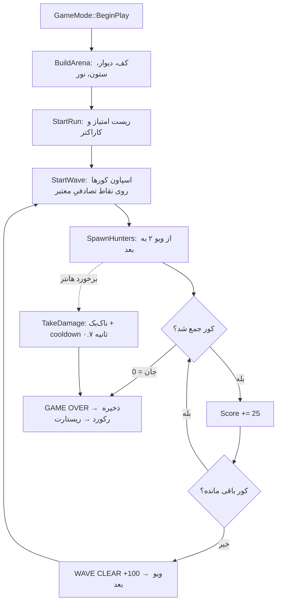

# Arena Runner — بازی سوم‌شخص با Unreal Engine 5.6

یک نمونه‌ی کامل و **کاملاً C++** از بازی سوم‌شخص با آنریل انجین ۵.۶: در یک آرنای گرد، کورهای انرژی را جمع می‌کنید، از ویو دوم به بعد «هانتر»های تعقیب‌گر دنبالتان می‌افتند و هر برخورد جان کم می‌کند. پروژه **بدون هیچ فایل `.uasset`** کار می‌کند؛ آرنا، کاراکتر، دوربین، HUD و آیتم‌ها همه در زمان اجرا با پریمیتیوهای خود انجین ساخته می‌شوند. یعنی clone می‌کنید، باز می‌کنید، Play — همین.

> **وضعیت:** این کد در محیط ما بدون نصب ادیتور آنریل نوشته شده (ادیتور در محیط ما موجود نیست)، پس اولین بیلد را شما انجام می‌دهید. اگر کامپایلر خطایی داد، متن خطا را بفرستید تا همان‌جا اصلاحش کنم. ساختار پروژه استاندارد UE است و از قالب‌های رسمی پیروی می‌کند.

---

## امکانات

| بخش | توضیح |
|---|---|
| کاراکتر سوم‌شخص | حرکت دوربین‌محور، پرش، اسپرینت (Shift)، شتاب/لگ دوربین با `USpringArmComponent` |
| آرنای رویه‌ای | کف، دیوارهای حلقه‌ای و ستون‌های تزئینی + نور خورشید، همه با `AStaticMeshActor` و مش‌های موتور |
| سیستم ویو | تعداد کورها هر ویو بیشتر می‌شود؛ امتیاز، جایزه‌ی پاک‌کردن ویو، بهترین رکورد ذخیره‌شده |
| دشمن تعقیب‌گر | `AArenaHunter`: گوی نارنجی که آرام تعقیب می‌کند، با برخورد ۱۴ آسیب می‌زند؛ همیشه از سرعت راه‌رفتن کندتر است تا قابل فرار باشد |
| بازخورد خطر | وینیت قرمز لبه‌ی صفحه وقتی هانتر نزدیک می‌شود + نمایش هانترها روی مینی‌مپ |
| HUD کدمحور | نوار جان، پنل امتیاز/ویو، مینی‌مپ، کراس‌هیر و پیام‌های وسط صفحه — بدون UMG |
| آسیب و مرگ | `TakeDamage` با cooldown، ناک‌بک، ریجن جان، حالت GAME OVER و ریستارت خودکار |
| Save | بهترین رکورد در `USaveGame` می‌ماند؛ تاریخچه‌ی ران‌ها در `UGameInstance` |
| ورودی | Input Manager کلاسیک (بدون نیاز به asset‌های Enhanced Input) — کیبورد + گیم‌پد |
| کانفیگ | `DefaultEngine/Game/Input.ini` آماده؛ GameMode/GameInstance/HUD از قبل وصل شده‌اند |
| **اندروید** | کنترل لمسی کامل (استیک شناور + ناحیه‌ی دوربین + دکمه‌های Jump/Run)، HUD مقیاس‌پذیر، تنظیمات پکیجینگ Android از قبل در `DefaultEngine.ini` |

## پیش‌نیازها

- **Unreal Engine 5.6** (از Epic Games Launcher → Library → Engine Versions)
- **Visual Studio 2022** با workloadهای:
  - `Game development with C++`
  - `Desktop development with C++` (MSVC v143 + Windows 10/11 SDK)
- روی لینوکس: toolchain رسمی Epic (`SetupToolchain.sh`) + `clang`؛ روی مک: Xcode 15+

## اجرا در ۴ قدم

```bash
# 1) فایل .uproject راست‌کلیک →  Generate Visual Studio project files
#    (یا از داخل ادیتور: File → Open Project)
# 2) ArenaRunner.uproject را باز کنید (اگر پرسید «Rebuild modules?» → Yes)
# 3) صبر کنید تا شیدرها کامپایل شوند (بار اول چند دقیقه)
# 4) Play (Alt+P)
```

نکته‌ی مهم: نیازی به ساختن مپ نیست. فایل `DefaultEngine.ini` مپ خالی خود موتور (`/Engine/Maps/Entry`) را باز می‌کند و `AArenaGameMode` در `BeginPlay` آرنا را می‌سازد. اگر خودتان مپ ساختید، دو خط `EditorStartupMap` و `GameDefaultMap` را به مپ خودتان تغییر دهید و داخل مپ یک `PlayerStart` بگذارید (کد حتی بدون `PlayerStart` هم کاراکتر را روی نقطه‌ی اسپاون می‌نشاند).

### اگر ادیتور فایل‌های پروژه را نساخت

```bash
# ویندوز (مسیر نسخه را تنظیم کنید)
"C:\Program Files\Epic Games\UE_5.6\Engine\Build\BatchFiles\Build.bat" ArenaRunnerEditor Win64 Development -Project="%CD%\ArenaRunner.uproject" -WaitMutex

# لینوکس
"$UE_ROOT/Engine/Build/BatchFiles/Linux/Build.sh" ArenaRunnerEditor Linux Development -Project="$PWD/ArenaRunner.uproject"
```

## کنترل‌ها

| عمل | کیبورد/ماوس | گیم‌پد |
|---|---|---|
| حرکت | `W A S D` یا کلیدهای جهت | استیک چپ |
| دوربین | ماوس | استیک راست |
| پرش | `Space` | A / ✕ |
| اسپرینت | `Left Shift` | LB |
| توقف بازی | `P` | Start |
| **موبایل / لمسی** | **نیمه‌ی چپ صفحه:** استیک شناور (هرجا انگشت بگذاری مرکزش همان‌جاست) · **نیمه‌ی راست:** کشیدن برای چرخاندن دوربین · دکمه‌ی **JUMP** · دکمه‌ی **RUN** (کلید اسپرینت) | |

هدف: هر ویو شامل تعدادی «کور انرژی» فیروزه‌ای است؛ با لمس‌کردن‌شان جمع می‌شوند. با پاک‌کردن هر ویو ۱۰۰ امتیاز جایزه می‌گیرید و ویو بعدی با کورهای بیشتر شروع می‌شود.

از **ویو ۲** یک هانتر اضافه می‌شود و هر ویو یکی بیشتر (تا سقف ۶ عدد)؛ هانترها آرام‌تر از شما حرکت می‌کنند ولی اگر گوشه‌ی آرنا گیر کنید، آسیب می‌خورید. با خالی‌شدن جان، صفحه‌ی GAME OVER می‌آید و ران جدید خودکار شروع می‌شود (بهترین رکورد ذخیره می‌شود).

## اندروید 📱

پروژه از قبل برای اندروید تنظیم شده است. سه چیز همیشه لازم است: SDK درست، کنترل لمسی، و پکیجینگ.

### ۱) پیش‌نیازها (نسخه‌های دقیق UE 5.6)

| مورد | نسخه |
|---|---|
| Android Studio | **Koala 2024.1.2** |
| Android SDK | **34** (حداقل قابل نصب روی گوشی: API 26 = اندروید ۸) |
| NDK | **r27c** (در 5.6.1 به بعد: `27.2.12479018`) |
| JDK | **21** (OpenJDK 21.0.3 — همان `jbr` داخل Android Studio) |
| Build-Tools | 34.0.0 (در 5.6.1+: 35.0.1) |

راه ساده‌ترین مسیر نصب، **Turnkey** خود انجین است: داخل ادیتور
`Platforms → SDK Management → Android → Install SDK`
این کار Android Studio، SDK، NDK و JDK سازگار با همان نسخه‌ی انجین را نصب می‌کند.

اگر دستی نصب می‌کنی، در Android Studio → `SDK Manager → SDK Tools`:
`Android SDK Command-line Tools (latest)` + `NDK 27.x` + `CMake` + `Build-Tools 34.0.0` + `Platform 34`.
سپس `Engine/Extras/Android/SetupAndroid.bat` (ویندوز) یا `.sh` (لینوکس/مک) را اجرا کن تا متغیرهای محیطی ست شوند.

### ۲) تنظیمات انجام‌شده در پروژه

در `Config/DefaultEngine.ini` بخش `[/Script/AndroidRuntimeSettings.AndroidRuntimeSettings]`:

| کلید | مقدار | چرا |
|---|---|---|
| `PackageName` | `com.arenarunner.game` | عوضش کن به `com.<اسم‌خودت>.<بازی>` |
| `MinSDKVersion` | `26` | حداقل موردنیاز UE 5.6 |
| `TargetSDKVersion` | `34` | الزام Google Play |
| `Orientation` | `Landscape` | بازی سوم‌شخص افقی بهتر است |
| `bBuildForArm64` | `True` | تنها ABI لازم برای گوشی‌های امروزی |
| `bBuildForArmV7` | `False` | حجم APK را کم می‌کند |
| `bBuildForES31` | `True` | OpenGL ES 3.2 (سازگاری بالا) |
| `bSupportsVulkan` | `True` | شیدرهای Vulkan هم همراه بیلد می‌شوند |
| `bDetectVulkanByDefault` | `False` | پیش‌فرض GLES؛ برای فعال‌کردن Vulkan `True` کن |
| `bPackageDataInsideApk` | `True` | فایل APK واحد و بدون OBB |
| `bEnableBundle` | `True` | خروجی `.aab` برای Google Play |

در `Config/Android/AndroidEngine.ini` هم تنظیمات موبایل (FXAA، سایه‌های سبک‌تر، HDR موبایل) آمده است.

### ۳) کنترل لمسی

| ناحیه | کار |
|---|---|
| نیمه‌ی چپ صفحه | استیک شناور؛ هرجای نیمه‌ی چپ انگشت بگذاری، مرکز استیک همان‌جا می‌شود و کشیدن انگشت = حرکت |
| نیمه‌ی راست صفحه | کشیدن انگشت = چرخش دوربین |
| دکمه‌ی `JUMP` (پایین راست) | پرش |
| دکمه‌ی `RUN` (کنار آن) | تاگل اسپرینت |

می‌خواهی روی ویندوز (PIE) هم ظاهر موبایل را ببینی؟
`AArenaHUD` یک پراپرتی `bForceMobileControls` دارد؛ در Blueprint فرزند HUD آن را `True` کن (یا برای تست سریع، در `ArenaHUD.h` مقدار پیش‌فرض را `true` بگذار). استیک و دکمه‌ها با ماوس هم کار می‌کنند.

> ویجت جوی‌استیک پیش‌فرض خود انجین عمداً خاموش شده است: `DefaultTouchInterface=None` در `DefaultInput.ini` (وگرنه دو استیک هم‌زمان روی صفحه دیده می‌شد).

### ۴) ساخت و نصب

**از ادیتور:**
`Platforms → Android → Package Project` → خروجی در `Build/Android/` (APK و AAB).
برای تست روی گوشی وصل‌شده با USB: `Platforms → Android → Deploy` (فقط APK).

**از خط فرمان (بدون باز کردن ادیتور):**
```bash
# ویندوز: RunUAT.bat — لینوکس/مک: RunUAT.sh
"$UE_ROOT/Engine/Build/BatchFiles/RunUAT.sh" BuildCookRun \
  -project="$PWD/ArenaRunner.uproject" -noP4 -platform=Android \
  -clientconfig=Development -cook -build -stage -pak -archive \
  -archivedirectory="$PWD/Build/Android" -allmaps
```
نصب روی گوشی:
```bash
adb install -r Build/Android/ArenaRunner-arm64.apk
```

**برای انتشار در Google Play:** خروجی `.aab` (با `bEnableBundle=True`) و امضا در
`Project Settings → Platforms → Android → Distribution Signing` (فایل keystore + alias + رمزها). فرمت تکسچر پیشنهادی برای پکیج: **ASTC**.

### ۵) بهینه‌سازی برای گوشی

- اگر روی گوشی ضعیف افت فریم داشتی: در `Config/Android/AndroidEngine.ini` خط `r.MobileContentScaleFactor=0.8` را از کامنت دربیاور.
- `r.MobileHDR=False` (نور کورها کم می‌شود ولی چند فریم می‌گیری).
- در `ArenaGameMode.h` مقدار `ArenaRadius` را برای صفحه‌ی کوچک از ۱۹۰۰ به حدود **۱۳۰۰** کم کن و `WallSegments` را ۲۴ بگذار.
- سایه‌ها را کم کن: در `Config/Android/AndroidEngine.ini` مقدار `r.Shadow.MaxResolution` را ۵۱۲ بگذار.
- Vulkan روی گوشی‌های جدید سریع‌تر است، ولی درایور بعضی گوشی‌ها مشکل دارد؛ برای انتشار عمومی GLES امن‌تر است (`bDetectVulkanByDefault=False`).

### ۶) عیب‌یابی اندروید

| خطا | علت / راه‌حل |
|---|---|
| `SDK not found` یا `NDK version mismatch` | Turnkey را اجرا کن یا `SetupAndroid.bat`؛ سپس ادیتور را کامل ببند و دوباره باز کن |
| `Gradle build failed` | `JAVA_HOME` باید روی JDK 21 باشد؛ پوشه‌های `Intermediate` و `Saved` را پاک کن |
| نصب می‌شود ولی صفحه سیاه است | `bPackageDataInsideApk=True` باشد و مپ در `GameDefaultMap` درست ست شده باشد |
| کنترل لمسی نمی‌آید | `bEnableTouchEvents` روی کنترلر (ست شده) و پلتفرم واقعاً موبایل باشد؛ برای تست در ویندوز `bForceMobileControls=True` |
| دو جوی‌استیک هم‌زمان | `DefaultTouchInterface=None` در `DefaultInput.ini` حذف نشده باشد |
| APK روی گوشی نصب نمی‌شود | `MinSDKVersion=26` و معماری `arm64` — شبیه‌سازهای x86 پشتیبانی نمی‌شوند |

## ساختار پروژه

```
ArenaRunner/
├─ ArenaRunner.uproject          # EngineAssociation = 5.6
├─ Config/
│  ├─ DefaultEngine.ini          # مپ پیش‌فرض، GameMode، GameInstance، رندر
│  ├─ DefaultGame.ini            # متادیتای پروژه، تنظیمات پکیج
│  ├─ Android/AndroidEngine.ini  # تنظیمات رندر مخصوص اندروید
│  └─ DefaultInput.ini           # محورها و اکشن‌ها (کیبورد + گیم‌پد)
├─ Content/                      # خالی است: همه‌چیز در کد ساخته می‌شود
└─ Source/
   ├─ ArenaRunner.Target.cs
   ├─ ArenaRunnerEditor.Target.cs
   └─ ArenaRunner/
      ├─ ArenaRunner.Build.cs    # Core, CoreUObject, Engine, InputCore
      ├─ ArenaRunner.h/.cpp      # IMPLEMENT_PRIMARY_GAME_MODULE
      ├─ ArenaCharacter.h/.cpp   # کاراکتر سوم‌شخص، دوربین، جان، اسپرینت
      ├─ ArenaGameMode.h/.cpp    # ساخت آرنا، چرخه‌ی ویوها، امتیاز، مرگ/ریستارت
      ├─ ArenaGameState.h        # امتیاز/ویو/بهترین رکورد برای HUD
      ├─ ArenaCollectible.h/.cpp # کور انرژی: چرخش، شنا، overlap
      ├─ ArenaHunter.h/.cpp      # دشمن تعقیب‌گر: حرکت به‌سمت بازیکن، آسیب تماسی
      ├─ ArenaPlayerController.h/.cpp # کیبورد + لمس: استیک شناور، ناحیه‌ی دوربین، دکمه‌ها
      ├─ ArenaHUD.h/.cpp         # HUD با Canvas (بدون UMG)
      ├─ ArenaPlayerController.h/.cpp
      ├─ ArenaGameInstance.h/.cpp
      └─ ArenaSaveGame.h         # SaveGame برای بهترین رکورد
```

### جریان اجرا



## شخصی‌سازی

همه‌ی اعداد به‌صورت `UPROPERTY(EditDefaultsOnly)` تعریف شده‌اند، پس بدون تغییر کد هم قابل تنظیم‌اند (Blueprint subclass یا تغییر مقدار پیش‌فرض):

- `ArenaGameMode.h`: `ArenaRadius`، `WallHeight`، `WallSegments`، `BaseCollectibleCount`، `CollectiblesPerWave`، `ScorePerCollectible`، `WaveClearBonus`، `RestartDelay`
- بخش هانترها در `ArenaGameMode.h`: `FirstHunterWave`، `MaxHunters`، `HunterBaseSpeed`، `HunterSpeedPerWave`، `HunterMaxSpeed`، `HunterContactDamage`
- `ArenaCharacter.h`: `MaxHealth`، `WalkSpeed`، `SprintSpeed`، `HealthRegenPerSecond`، `KnockBackStrength`، `DamageCooldown`
- `ArenaCollectible.cpp`: رنگ کور/هاله، `SpinSpeed`، `BobHeight`

مثلاً برای سخت‌تر کردن بازی، در `ArenaGameMode.h` مقدار `CollectiblesPerWave` را از ۲ به ۳ ببرید یا `FirstHunterWave` را ۱ کنید. برای آسان‌تر شدن، `HunterMaxSpeed` را به ۳۴۰ و `HunterContactDamage` را به ۸ کم کنید. برای کاراکتر واقعی، `BodyMesh`/`HeadMesh` را با `USkeletalMeshComponent` و انیمیشن جایگزین کنید.

### پکیج‌کردن

`Platforms → Windows → Package Project` (یا `Mac`/`Linux`). خروجی در مسیری که انتخاب می‌کنید و در پوشه‌ی `Windows/` ساخته می‌شود. اگر مپ اختصاصی نساختید، قبل از پکیج‌کردن یک مپ خالی در `Content/Maps/Arena` بسازید و آن را به `DefaultEngine.ini` وصل کنید تا مطمئن باشید کوک می‌شود.

## آپلود روی گیت‌هاب

`.gitignore` مخصوص آنریل از قبل هست (`Binaries/`، `Intermediate/`، `Saved/`، `DerivedDataCache/`، `.vs/` و فایل‌های `.sln` را نادیده می‌گیرد) و `.gitattributes` فایل‌های باینری را درست علامت زده است.

```bash
cd ArenaRunner
git init
git add .
git commit -m "Initial commit: Arena Runner (UE 5.6, C++ third-person arena)"
git branch -M main
git remote add origin https://github.com/<USERNAME>/ArenaRunner.git
git push -u origin main
```

یک ریپوی خالی در GitHub بسازید (بدون README) و همان دو خط آخر را اجرا کنید. اگر گیت‌هاب CLI دارید:

```bash
gh repo create ArenaRunner --public --source=. --remote=origin --push
```

> توصیه: برای پروژه‌های بزرگ UE از **Git LFS** برای `*.uasset` و `*.umap` استفاده کنید. این نمونه فایل باینری ندارد، پس لازم نیست؛ ولی اگر محتوا اضافه کردید:
> ```bash
> git lfs install
> git lfs track "*.uasset" "*.umap"
> git add .gitattributes
> ```

## عیب‌یابی

| مشکل | راه‌حل |
|---|---|
| `Could not be compiled. Try rebuilding from source manually` | از VS با Configuration `Development Editor` و Platform `Win64` بیلد کنید، یا دستور Build بالا را اجرا کنید |
| کاراکتر حرکت نمی‌کند | `Project Settings → Input → Default Classes` باید `PlayerInput` و `InputComponent` کلاسیک باشند (در `DefaultInput.ini` ست شده‌اند). ماوس را روی Viewport کلیک کنید |
| همه‌چیز تیره و سیاه است | مپ شما احتمالاً Lighting نیاز دارد؛ GameMode یک Directional Light اضافه می‌کند. اگر باز هم تیره بود، `r.DefaultFeature.AutoExposure=False` را در `DefaultEngine.ini` بردارید |
| مینی‌مپ خالی است | کاراکتر باید اسپاون شده باشد؛ اگر مپ خودتان است، مطمئن شوید `GlobalDefaultGameMode` تغییر نکرده |
| ادیتور مپ `Entry` را پیدا نمی‌کند | یک مپ خالی بسازید (`File → New Level → Empty Level`) و در `DefaultEngine.ini` مسیرش را بگذارید |
| فریم‌ریت پایین در ادیتور | `ArenaRadius` را کم کنید یا `WallSegments` را از ۴۰ به ۲۰ برسانید |

## نقشه‌ی راه (ایده برای ادامه)

- [x] دشمن تعقیب‌گر (`AArenaHunter`)
- [ ] دشمن با `AIController` و رفتار پیچیده‌تر (دور زدن موانع، حمله‌ی دوره‌ای)
- [ ] شلیک پرتابی (Projectile) و سیستم جان دشمن
- [ ] منوی اصلی و صفحه‌ی پایان با UMG
- [x] کنترل لمسی و پشتیبانی اندروید
- [ ] صدا و افکت ذرات برای جمع‌کردن کور
- [ ] ذخیره‌ی کامل ران (زمان، ویو، امتیاز) در SaveGame

## لایسنس

MIT — فایل [LICENSE](LICENSE). استفاده از موتور آنریل تابع شرایط لایسنس خود Epic Games است.

---

## English quick start

**Arena Runner** is a fully C++ third-person wave-survival sample for **Unreal Engine 5.6**. No content assets are required — the arena, player visuals, pickups and HUD are all built at runtime from engine primitives.

1. Right-click `ArenaRunner.uproject` → **Generate Visual Studio project files**
2. Open the `.uproject`, accept the module rebuild prompt
3. Press **Play**

**Controls:** WASD / left stick to move, mouse / right stick to look, Space / A to jump, Shift / LB to sprint, P / Start to pause.
**Mobile:** floating stick on the left half, drag the right half to look, JUMP / RUN buttons on the bottom right.
Collect every cyan energy core to clear the wave; each wave adds more cores and one more red chasing **Hunter** (slow, but it hurts). Your best score is saved between sessions.

Built with `USpringArmComponent` + `UCameraComponent`, an `AHUD`-driven Canvas UI, an `AGameModeBase` run loop with a chasing hazard actor, `USaveGame` persistence and classic Input Manager bindings (`Config/DefaultInput.ini`).

**Android:** preconfigured in `Config/DefaultEngine.ini` (`[/Script/AndroidRuntimeSettings.AndroidRuntimeSettings]`: SDK 26/34, arm64, GLES 3.2 + Vulkan shaders, APK with embedded data, AAB enabled). Requires Android Studio Koala 2024.1.2 / SDK 34 / NDK r27c / JDK 21 — the easiest install is **Turnkey**: `Platforms → SDK Management → Android → Install SDK`. Package with `Platforms → Android → Package Project`, or `RunUAT BuildCookRun -platform=Android`. Touch input lives in `AArenaPlayerController` and the on-screen controls are drawn by `AArenaHUD::DrawMobileControls`; set `AArenaHUD::bForceMobileControls` to test the touch layout in PIE.
